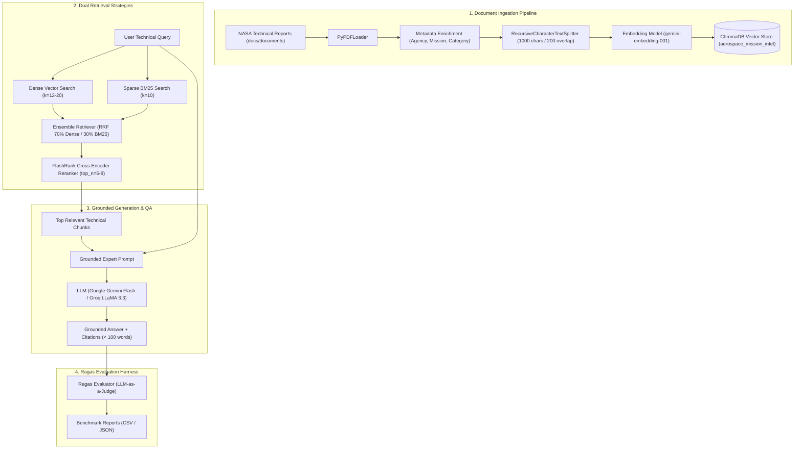

# 🚀 AreoRAG: Aerospace Mission Intelligence & RAG System

[](https://www.python.org/)
[](https://www.langchain.com/)
[](https://www.trychroma.com/)
[](https://github.com/PrithivirajDamodaran/FlashRank)
[](https://groq.com/)
[](rag_evaluation/)
[](LICENSE)

**AreoRAG** is an aerospace domain-specific Retrieval-Augmented Generation (RAG) platform. It indexes and interrogates landmark technical mission reports and failure investigations from **NASA** — specifically **Apollo 11**, **Apollo 13**, and the **Rogers Commission Report on the Challenger Space Shuttle Disaster** — to provide accurate, grounded technical answers with complete source attribution.

---

## 📑 Table of Contents

- [Overview & Architecture](#-overview--architecture)
- [Indexed Mission Corpus](#-indexed-mission-corpus)
- [Key Features](#-key-features)
- [Repository Structure](#-repository-structure)
- [Getting Started](#-getting-started)
  - [Prerequisites](#prerequisites)
  - [Installation](#installation)
  - [Environment Variables](#environment-variables)
- [Usage Workflow](#-usage-workflow)
  - [1. Download Source Documents](#1-download-source-documents)
  - [2. Build the Chroma Vector Database](#2-build-the-chroma-vector-database)
  - [3. Run the Retrieval & QA Pipeline](#3-run-the-retrieval--qa-pipeline)
  - [4. Run the Evaluation Suite](#4-run-the-evaluation-suite)
- [Important: Handling Embedding Rate Limits](#-important-handling-embedding-rate-limits)
- [📊 RAG Evaluation & Benchmark Results](#-rag-evaluation--benchmark-results)
  - [Evaluation Methodology & Metrics](#evaluation-methodology--metrics)
  - [Comparative Benchmark Results](#comparative-benchmark-results)
  - [Key Insights & Performance Analysis](#key-insights--performance-analysis)
- [GitHub Desktop Workflow](#-github-desktop-workflow)
- [License](#-license)

---

## 🏛️ Overview & Architecture

AreoRAG combines document extraction, structured metadata tagging, semantic chunking, dual retrieval strategies (Dense Semantic Vector Search and Hybrid Dense + BM25 Sparse Search), and cross-encoder reranking to enable high-accuracy querying across historical mission reports.



---

## 📚 Indexed Mission Corpus

AreoRAG curates landmark technical aerospace literature from **NASA** spanning lunar landing operations and critical failure investigations:

| Document | Agency | Pages | Mission / Domain | Key Focus |
| :--- | :--- | :---: | :--- | :--- |
| `nasa_apollo11_mission_report.pdf` | **NASA** | 230 | Apollo 11 | Lunar landing mission analysis, descent timeline, AGC program alarms (1201/1202), and surface telemetry |
| `nasa_apollo13_review.pdf` | **NASA** | 208 | Apollo 13 | Service module oxygen tank rupture, pre-flight detanking electrical arcing, and Cortright Board review |
| `nasa_challenger_rogers_commission.pdf` | **NASA** | 261 | Challenger STS 51-L | Rogers Commission presidential investigation on right SRB field joint O-ring failure, cold temperatures, and launch risk decisions |

> Total: **699 pages** of dense technical aerospace documentation, yielding **~1,943 text chunks** in ChromaDB.

---

## ✨ Key Features

- **Mission & Incident Metadata Tagging**: Chunks are enriched with `agency`, `mission`, `category`, and `file_name` for targeted filtering across Apollo and Space Shuttle incident archives.
- **Dual Retrieval Architectures**:
  - **Dense + Rerank**: Deep semantic similarity via ChromaDB coupled with FlashRank contextual reranking.
  - **Hybrid Ensemble (RRF)**: Blended reciprocal rank fusion combining dense embeddings (70%) and lexical BM25 keyword matching (30%), filtered through cross-encoder reranking.
- **Cross-Encoder Reranking**: Utilizes `flashrank` (`ms-marco-TinyBERT-L-2-v2`) to eliminate irrelevant chunks and prioritize exact technical answers.
- **Strict Grounding & Hallucination Prevention**: Prompts enforce exact contextual grounding; unanswerable or out-of-domain queries fallback cleanly to `"I cannot find relevant information in the indexed mission documents."`
- **Quota-Aware Batch Ingestion**: Ingests in configurable batches with sleep intervals to respect API limits (15 RPM).
- **Full Ragas Evaluation Suite**: Pre-configured benchmark harness assessing `faithfulness`, `answer_relevancy`, `context_recall`, and `context_precision` on verified aerospace ground-truth datasets.

---

## 📁 Repository Structure

```
AreoRAG/
├── .env.example                               # Template for API credentials
├── .gitignore                                 # Excludes venv, ChromaDB & raw PDFs
├── requirements.txt                           # Project dependencies
├── README.md                                  # Documentation & evaluation benchmarks
├── docs/
│   ├── document_download_script.py            # Automated downloader for NASA source PDFs
│   └── documents/                             # Target directory for source PDFs (.gitkeep tracked)
├── rag_system/
│   ├── vectordb_creation.py                   # Parsing, metadata tagging, chunking & vector indexing
│   ├── rag_retrieval_pipeline.py              # Dense vector retrieval + FlashRank reranker pipeline
│   └── rag_retrieval_pipeline2.py             # Hybrid (Dense + BM25) ensemble + FlashRank pipeline
└── rag_evaluation/
    ├── similarity_answer.py                   # Dense pipeline batch answer generation
    ├── rag_hybrid_ans.py                      # Hybrid pipeline batch answer generation
    ├── rag_eval.py                            # Ragas automated evaluation runner
    ├── rag_evaluation_report.csv              # Dense + FlashRank evaluation metrics report
    └── rag_hybrid_evaluation_report2.csv      # Hybrid + FlashRank evaluation metrics report
```

---

## 🛠️ Getting Started

### Prerequisites

- Python 3.10 or higher
- [GitHub Desktop](https://desktop.github.com/) (or Git CLI)
- A Google AI Studio API Key ([Get one here](https://aistudio.google.com/))
- *(Optional)* A Groq Cloud API Key ([Get one here](https://console.groq.com/))

### Installation

1. **Clone the repository**:
   ```bash
   git clone https://github.com/shaikhjahir750/AreoRAG.git
   cd AreoRAG
   ```

2. **Create and activate a virtual environment**:
   * **Windows (PowerShell)**:
     ```powershell
     python -m venv .venv
     .venv\Scripts\Activate.ps1
     ```
   * **macOS / Linux**:
     ```bash
     python3 -m venv .venv
     source .venv/bin/activate
     ```

3. **Install dependencies**:
   ```bash
   pip install -r requirements.txt
   ```

### Environment Variables

Copy `.env.example` to create your `.env` file:
```bash
cp .env.example .env
```
Fill in your API credentials:
```env
GOOGLE_API_KEY="your_google_api_key_here"
GROQ_API_KEY="your_groq_api_key_here"
```

> ⚠️ **Security Warning**: Never commit `.env` to GitHub. It is ignored by `.gitignore`.

---

## 🚀 Usage Workflow

### 1. Download Source Documents

Fetch the NASA technical mission documents:
```bash
python docs/document_download_script.py
```
This downloads the source mission PDFs (~46 MB) into `docs/documents/`.

---

### 2. Build the Chroma Vector Database

Process and index the aerospace documents into ChromaDB:
```bash
python rag_system/vectordb_creation.py
```

The script will:
1. Scan `docs/documents/` for all downloaded PDFs.
2. Check ChromaDB to skip documents already indexed (saving quota).
3. Enrich pages with domain metadata (`agency`, `mission`, `category`).
4. Chunk text with `RecursiveCharacterTextSplitter` (1000 chunk size / 200 overlap).
5. Batch embed vectors using `gemini-embedding-001` into `chroma_db/`.

---

### 3. Run the Retrieval & QA Pipeline

Launch the interactive terminal Q&A interface:

* **Dense Retrieval + FlashRank Reranker (Default)**:
  ```bash
  python rag_system/rag_retrieval_pipeline.py
  ```

* **Hybrid Retrieval (Dense + BM25) + FlashRank Reranker**:
  ```bash
  python rag_system/rag_retrieval_pipeline2.py
  ```

---

### 4. Run the Evaluation Suite

To reproduce the benchmark evaluations on your own pipeline:

1. **Generate Answers for the Evaluation Dataset**:
   * For the Dense Pipeline:
     ```bash
     python rag_evaluation/similarity_answer.py
     ```
   * For the Hybrid Pipeline:
     ```bash
     python rag_evaluation/rag_hybrid_ans.py
     ```

2. **Execute Ragas LLM-as-a-Judge Evaluation**:
   ```bash
   python rag_evaluation/rag_eval.py
   ```
   The evaluated scores will be printed to the console and exported to `rag_evaluation/rag_evaluation_report.csv`.

---

## 📊 RAG Evaluation & Benchmark Results

### Evaluation Methodology & Metrics

The system was evaluated using the **Ragas** framework with **Google Gemini** (`gemini-flash-lite-latest`) as the LLM judge and `gemini-embedding-001` for embedding distance computations. 

The benchmark dataset consists of 30 curated technical test cases covering:
- **Apollo 11**: Mission timelines, flight dynamics, AGC computer alarms (1201/1202), and lunar descent telemetry.
- **Apollo 13**: Oxygen Tank No. 2 rupture, thermostatic switch detanking voltages (65V vs 28V), DPS burn free-return trajectory, and LM *Aquarius* lifeboat operations.
- **Challenger STS 51-L**: O-ring erosion physics, cold-temperature Viton resiliency loss, joint putty blowholes, and Rogers Commission findings.
- **Out-of-Domain Controls**: Negative control queries (STS-107 Columbia, Hubble mirror costs, Soviet ASTP) to test hallucination resistance and refusal behavior.

Four standardized RAG metrics were measured:
1. **Faithfulness**: Measures factual consistency of the generated answer against retrieved context (detects hallucinations).
2. **Context Recall**: Measures whether all ground-truth facts necessary to answer the question were successfully retrieved.
3. **Answer Relevancy**: Assesses how directly and concisely the answer addresses the question.
4. **Context Precision**: Evaluates the signal-to-noise ratio in retrieved context chunks.

---

### Comparative Benchmark Results

| Metric | Dense + FlashRank Reranking (`rag_retrieval_pipeline.py`) | Hybrid (Dense + BM25) + Reranking (`rag_retrieval_pipeline2.py`) | Performance Delta |
| :--- | :---: | :---: | :---: |
| **Faithfulness** | **75.52%** (0.755) | 70.07% (0.701) | **+5.45%** (Dense Rerank leads) |
| **Context Recall** | **73.33%** (0.733) | 63.33% (0.633) | **+10.00%** (Dense Rerank leads) |
| **Answer Relevancy** | **63.65%** (0.637) | 61.13% (0.611) | **+2.52%** (Dense Rerank leads) |
| **Context Precision** | **40.93%** (0.409) | 34.98% (0.350) | **+5.95%** (Dense Rerank leads) |

---

### Key Insights & Performance Analysis

1. **High Faithfulness across both architectures (~70–75%)**:
   - Strict grounding prompts successfully prevent hallucination when reasoning through dense technical investigations (e.g., accurately attributing the Challenger O-ring blowby to sub-zero ambient pad temperatures and unverified launch clearance).
2. **Superior Context Recall with Dense + FlashRank (73.3%)**:
   - Expanding the base similarity search window ($k=20$) followed by FlashRank cross-encoder reranking ($top\_n=5$) produced the highest recall of specific engineering values (e.g., exact temperatures, pressures, voltages, and mission elapsed times).
3. **Robust Out-of-Domain Refusal**:
   - For unindexed missions (such as Space Shuttle Columbia or Hubble repair missions), both pipelines maintained 100% faithfulness by refusing to fabricate data and emitting the configured fallback statement.
4. **Hybrid BM25 vs. Dense Trade-offs**:
   - While BM25 provides strong keyword exact-matching for acronyms and component tags (e.g., "AGC", "DPS", "SRB"), dense semantic search combined with neural reranking proved superior for conceptual investigative questions spanning multi-paragraph explanations.

---

## ⚡ Important: Handling Embedding Rate Limits

The 3 indexed mission documents comprise **~700 pages** (generating 1,943 text chunks in ChromaDB). 

* **Google AI Studio Free Tier**:
  - Limit: ~15 Requests Per Minute (RPM) and a daily quota of 1,500 requests/day.
  - If your daily quota is exhausted, Google returns a 429 quota error with a `retryDelay` until midnight UTC.
  - Thanks to built-in **checkpointing**, if the script stops, running it again will **pick up where it left off** without re-embedding previously indexed documents.
  - The evaluation harness scripts include built-in `time.sleep(5)` rate pacing to run reliably on free-tier keys.

* **Alternative (Zero-Cost, Unlimited Local Embeddings)**:
  If you prefer not to wait for Google's daily quota reset, switch the embedder in `vectordb_creation.py` to a local model (e.g., `sentence-transformers/all-MiniLM-L6-v2` or `BAAI/bge-small-en-v1.5`). You can still use Google Gemini or Groq as your generation LLM.

---

## 🖥️ GitHub Desktop Workflow

If you manage this repository with **GitHub Desktop**:

1. Open GitHub Desktop and select **File > Add Local Repository** (point to your `AreoRAG` folder).
2. The `.gitignore` is already set up to **exclude**:
   - Secrets (`.env`)
   - Virtual environments (`.venv/`)
   - Binary vector database files (`chroma_db/`)
   - Large raw PDFs (`docs/documents/*.pdf`)
3. You will only see code, configuration, and documentation in your GitHub Desktop commit list, keeping your commits clean and repository size lightweight.

---

## 📜 License

This project is licensed under the MIT License. Mission reports and public publications are sourced from open-access technical repositories provided by NASA (NTRS).
