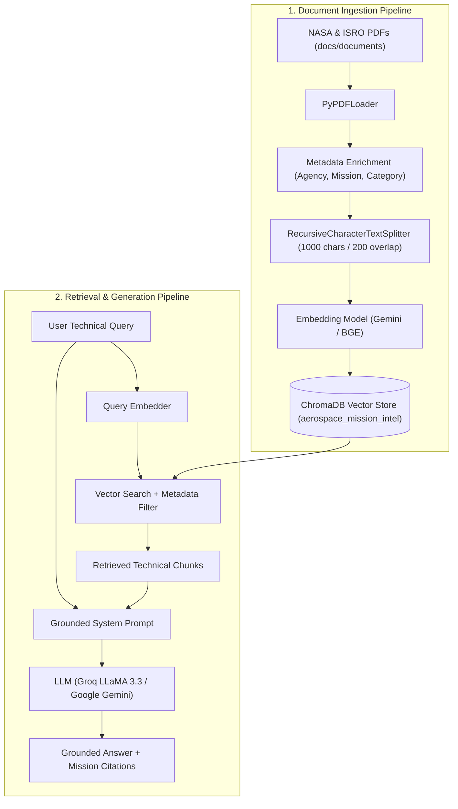

# 🚀 AreoRAG: Aerospace Mission Intelligence & RAG System

[](https://www.python.org/)
[](https://www.langchain.com/)
[](https://www.trychroma.com/)
[](https://groq.com/)
[](LICENSE)

**AreoRAG** is an aerospace domain-specific Retrieval-Augmented Generation (RAG) platform. It indexes and interrogates technical mission reports, anomaly investigations, flight handbooks, and mission booklets from **NASA** and **ISRO** to provide accurate, grounded technical answers with complete source attribution.

---

## 📑 Table of Contents

- [Overview & Architecture](#-overview--architecture)
- [Indexed Mission Corpus](#-indexed-mission-corpus)
- [Key Features](#-key-features)
- [Repository Structure](#-repository-structure)
- [Getting Started](#-getting-started)
  - [Prerequisites](#prerequisites)
  - [Installation](#installation)
  - [Environment Variables](#environment-variables)
- [Usage Workflow](#-usage-workflow)
  - [1. Download Source Documents](#1-download-source-documents)
  - [2. Build the Chroma Vector Database](#2-build-the-chroma-vector-database)
  - [3. Run the Retrieval Pipeline](#3-run-the-retrieval-pipeline)
- [Important: Handling Embedding Rate Limits](#-important-handling-embedding-rate-limits)
- [RAG Evaluation (Upcoming)](#-rag-evaluation-upcoming)
- [GitHub Desktop Workflow](#-github-desktop-workflow)
- [License](#-license)

---

## 🏛️ Overview & Architecture

AreoRAG combines document extraction, structured metadata tagging, semantic chunking, and vector storage to enable high-accuracy querying across historical and modern space missions.



---

## 📚 Indexed Mission Corpus

AreoRAG curates technical aerospace literature across two major space agencies:

| Document | Agency | Pages | Mission / Domain | Key Focus |
| :--- | :--- | :---: | :--- | :--- |
| `nasa_apollo11_mission_report.pdf` | **NASA** | 230 | Apollo 11 | Lunar landing mission analysis, trajectory, flight timeline |
| `nasa_apollo13_review.pdf` | **NASA** | 208 | Apollo 13 | Service module oxygen tank rupture & anomaly investigation |
| `nasa_challenger_rogers_commission.pdf` | **NASA** | 261 | Challenger STS 51-L | Rogers Commission presidential report on O-ring failure |
| `nasa_systems_engineering_handbook.pdf` | **NASA** | 14 | NASA Standards | Systems engineering fundamentals, verification & validation |
| `isro_chandrayaan1_publication.pdf` | **ISRO** | 8 | Chandrayaan-1 | Lunar orbit insertion, payloads, and lunar water discovery |
| `isro_aditya_l1_booklet.pdf` | **ISRO** | 14 | Aditya-L1 | Solar coronagraphy, heliophysics, Lagrange Point 1 science |
| `isro_gaganyaan_tvd1.pdf` | **ISRO** | 12 | Gaganyaan TV-D1 | In-flight abort demonstration & crew module escape test |
| `isro_space_achievements_tech.pdf` | **ISRO** | 13 | ISRO Overview | Launch vehicle architectures (PSLV, GSLV, LVM3) and telemetry |

---

## ✨ Key Features

- **Multi-Agency Metadata Tagging**: Chunks are enriched with `agency`, `mission`, `category`, and `file_name` for targeted filtering (e.g., query *only* Apollo anomaly reports or *only* ISRO crew safety tests).
- **Quota-Aware Batch Ingestion**: Ingests in 15-chunk batches with explicit delays to respect API rate limits.
- **Checkpointing & Deduplication**: Checks existing Chroma collections to prevent re-embedding already indexed files, saving API tokens.
- **Dual LLM Provider Support**: Compatible with Google Gemini for native embeddings and Groq (LLaMA 3.3 70B) for ultra-fast response generation.
- **Contextual Reranking**: Integrates Flashrank reranking to optimize precision across dense technical passages.
- **Evaluation Framework (Coming Soon)**: Automated LLM-as-a-judge benchmarking using RAGAS and custom aerospace evaluation datasets is actively planned and will be introduced in coming updates.

---

## 📁 Repository Structure

```
AreoRAG/
├── .env.example                     # Sample template for API keys
├── .gitignore                       # Configured for GitHub Desktop, venv, ChromaDB & PDFs
├── requirements.txt                 # Project dependencies
├── README.md                        # Project documentation
├── docs/
│   ├── document_download_script.py # Automated downloader for NASA/ISRO PDFs
│   └── documents/                  # Target directory for source PDFs (.gitkeep tracked)
├── rag_system/
│   ├── vectordb_creation.py        # PDF parsing, metadata tagging, chunking & vector indexing
│   └── rag_retrieval_pipeline.py   # Vector retrieval, reranking & grounded QA pipeline
└── rag_evaluation/                 # [Upcoming Release] RAGAS benchmarks & evaluation suites
```

---

## 🛠️ Getting Started

### Prerequisites

- Python 3.10 or higher
- [GitHub Desktop](https://desktop.github.com/) (or Git CLI)
- A Google AI Studio API Key ([Get one here](https://aistudio.google.com/))
- *(Optional)* A Groq Cloud API Key for ultra-fast generation ([Get one here](https://console.groq.com/))

### Installation

1. **Clone the repository** (using GitHub Desktop or terminal):
   ```bash
   git clone https://github.com/shaikhjahir750/AreoRAG.git
   cd AreoRAG
   ```

2. **Create and activate a virtual environment**:
   * **Windows (PowerShell)**:
     ```powershell
     python -m venv .venv
     .venv\Scripts\Activate.ps1
     ```
   * **macOS / Linux**:
     ```bash
     python3 -m venv .venv
     source .venv/bin/activate
     ```

3. **Install dependencies**:
   ```bash
   pip install -r requirements.txt
   ```

### Environment Variables

Copy `.env.example` to create your `.env` file:
```bash
cp .env.example .env
```
Open `.env` and fill in your API credentials:
```env
GOOGLE_API_KEY="your_google_api_key_here"
GROQ_API_KEY="your_groq_api_key_here"
```

> ⚠️ **Security Warning**: Never commit `.env` to GitHub. It is ignored by `.gitignore`.

---

## 🚀 Usage Workflow

### 1. Download Source Documents

Fetch all NASA and ISRO technical documents:
```bash
python docs/document_download_script.py
```
This downloads all 8 PDF publications (~90 MB) into `docs/documents/`.

---

### 2. Build the Chroma Vector Database

Process and index the aerospace documents into ChromaDB:
```bash
python rag_system/vectordb_creation.py
```

The script will:
1. Scan `docs/documents/` for all downloaded PDFs.
2. Check ChromaDB to skip documents already indexed (saving quota).
3. Enrich pages with domain metadata (`agency`, `mission`, `category`).
4. Chunk text with `RecursiveCharacterTextSplitter`.
5. Batch embed vectors using Google's embedding model into `chroma_db/`.

---

### 3. Run the Retrieval Pipeline

Query the indexed aerospace corpus via the interactive terminal interface:
```bash
python rag_system/rag_retrieval_pipeline.py
```

---

## ⚡ Important: Handling Embedding Rate Limits

The documents contain **~760 pages**, generating thousands of text chunks. 

* **Google AI Studio Free Tier**:
  - Limit: ~15 Requests Per Minute (RPM) and a daily quota of 1,500 requests/day.
  - If your daily quota is exhausted, Google returns a 429 quota error with a `retryDelay` until midnight UTC.
  - Thanks to built-in **checkpointing**, if the script stops, running it again will **pick up where it left off** without re-embedding previously indexed documents.

* **Alternative (Zero-Cost, Unlimited Local Embeddings)**:
  If you prefer not to wait for Google's daily quota reset, switch the embedder in `vectordb_creation.py` to a local model (e.g., `sentence-transformers/all-MiniLM-L6-v2` or `BAAI/bge-small-en-v1.5`). You can still use Google Gemini or Groq as your generation LLM.

---

## 📊 RAG Evaluation (Upcoming)

> [!NOTE]
> **Work in Progress / Coming Soon**:
> Formal evaluation of the retrieval and generation pipeline will be released in coming updates. The upcoming evaluation framework includes:
> - **Metrics**: Quantitative tracking of `context_precision`, `context_recall`, `faithfulness`, and `answer_relevancy` using the [Ragas](https://github.com/explodinggradients/ragas) framework.
> - **Aerospace Benchmark Dataset**: Curated ground-truth test queries covering Apollo 11, Apollo 13, and Challenger STS 51-L anomaly investigations, cross-mission reasoning, and out-of-domain negative controls.
> - **Comparative Benchmarking**: Comparative analysis between standard vector retrieval, reranked retrieval (Flashrank), and hybrid retrieval architectures.
> 
> *Full evaluation scripts, configuration instructions, and benchmark evaluation reports will be officially published here in coming times.*

---

## 🖥️ GitHub Desktop Workflow

If you manage this repository with **GitHub Desktop**:

1. Open GitHub Desktop and select **File > Add Local Repository** (point to your `AreoRAG` folder).
2. The `.gitignore` is already set up to **exclude**:
   - Secrets (`.env`)
   - Virtual environments (`.venv/`)
   - Binary vector database files (`chroma_db/`)
   - Large raw PDFs (`docs/documents/*.pdf`)
3. You will only see code, configuration, and documentation in your GitHub Desktop commit list, keeping your commits clean and repository size lightweight.

---

## 📜 License

This project is licensed under the MIT License. Mission reports and public publications are sourced from open-access repositories provided by NASA and ISRO.
