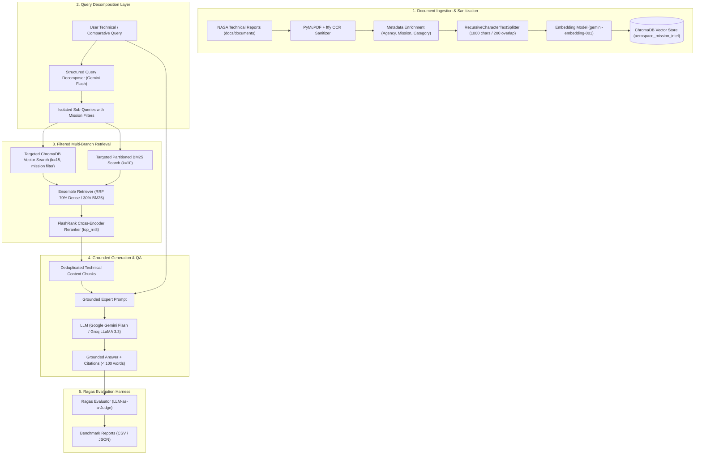

# 🚀 AreoRAG: Aerospace Mission Intelligence & RAG System

[](https://www.python.org/)
[](https://www.langchain.com/)
[](https://www.trychroma.com/)
[](https://github.com/PrithivirajDamodaran/FlashRank)
[](https://groq.com/)
[](rag_evaluation/)
[](LICENSE)

**AreoRAG** is an aerospace domain-specific Retrieval-Augmented Generation (RAG) platform. It indexes and interrogates landmark technical mission reports and failure investigations from **NASA** — specifically **Apollo 11**, **Apollo 13**, and the **Rogers Commission Report on the Challenger Space Shuttle Disaster** — to provide accurate, grounded technical answers with complete source attribution.

---

## 📑 Table of Contents

- [Overview & Architecture](#-overview--architecture)
- [Indexed Mission Corpus](#-indexed-mission-corpus)
- [Key Features](#-key-features)
- [Repository Structure](#-repository-structure)
- [Getting Started](#-getting-started)
  - [Prerequisites](#prerequisites)
  - [Installation](#installation)
  - [Environment Variables](#environment-variables)
- [Usage Workflow](#-usage-workflow)
  - [1. Download Source Documents](#1-download-source-documents)
  - [2. Preprocess Scanned PDFs & Build ChromaDB](#2-preprocess-scanned-pdfs--build-chromadb)
  - [3. Run the Retrieval & QA Pipeline](#3-run-the-retrieval--qa-pipeline)
  - [4. Run the Evaluation Suite](#4-run-the-evaluation-suite)
- [Important: Handling Embedding Rate Limits](#-important-handling-embedding-rate-limits)
- [📊 RAG Evaluation & Benchmark Results](#-rag-evaluation--benchmark-results)
  - [Evaluation Methodology & Metrics](#evaluation-methodology--metrics)
  - [Before vs. After Optimization Benchmarks](#before-vs-after-optimization-benchmarks)
  - [What Improved & Why: Technical Analysis](#what-improved--why-technical-analysis)
- [GitHub Desktop Workflow](#-github-desktop-workflow)
- [License](#-license)

---

## 🏛️ Overview & Architecture

AreoRAG combines OCR text sanitization, structured metadata tagging, semantic chunking, query decomposition planning, dual retrieval strategies (Dense Semantic Vector Search and Hybrid Dense + BM25 Sparse Search), and cross-encoder reranking to achieve high-precision answering across historical mission documentation.



---

## 📚 Indexed Mission Corpus

AreoRAG curates landmark technical aerospace literature from **NASA** spanning lunar landing operations and critical failure investigations:

| Document | Agency | Pages | Mission / Domain | Key Focus |
| :--- | :--- | :---: | :--- | :--- |
| `nasa_apollo11_mission_report.pdf` | **NASA** | 230 | Apollo 11 | Lunar landing mission analysis, descent timeline, AGC program alarms (1201/1202), and surface telemetry |
| `nasa_apollo13_review.pdf` | **NASA** | 208 | Apollo 13 | Service module oxygen tank rupture, pre-flight detanking electrical arcing, and Cortright Board review |
| `nasa_challenger_rogers_commission.pdf` | **NASA** | 261 | Challenger STS 51-L | Rogers Commission presidential investigation on right SRB field joint O-ring failure, cold temperatures, and launch risk decisions |

> Total: **699 pages** of dense technical aerospace documentation, yielding **~1,943 text chunks** in ChromaDB.

---

## ✨ Key Features

- **Query Decomposition & Mission Planning**: Dissects complex, cross-mission, or comparative inquiries (e.g., comparing Apollo 13 tank failures with Challenger O-ring decisions) into self-contained sub-queries targeting individual missions with exact ChromaDB metadata filters (`filter={"mission": sq.mission}`).
- **Scanned PDF OCR Sanitization**: Custom preprocessing (`scanedPDF_to_cleanedTXT.py`) with `PyMuPDF` and `ftfy` cleans broken unicode, corrects OCR character substitutions (e.g., `en$neering` $\rightarrow$ `engineering`), repairs hyphenated line wraps, and strips non-printable scanner noise.
- **Dual Retrieval Architectures**:
  - **Dense + Rerank**: Deep semantic similarity via ChromaDB coupled with FlashRank contextual reranking.
  - **Hybrid Ensemble (RRF)**: Blended reciprocal rank fusion combining dense embeddings (70%) and lexical BM25 keyword matching (30%), filtered through cross-encoder reranking.
- **Cross-Encoder Reranking**: Utilizes `flashrank` (`ms-marco-TinyBERT-L-2-v2`) to eliminate irrelevant chunks and prioritize exact technical answers.
- **Strict Grounding & Hallucination Prevention**: Prompts enforce exact contextual grounding; unanswerable or out-of-domain queries fallback cleanly to `"I cannot find relevant information in the indexed mission documents."`
- **Quota-Aware Batch Ingestion**: Ingests in configurable batches with sleep intervals to respect API limits (15 RPM).
- **Full Ragas Evaluation Suite**: Pre-configured benchmark harness assessing `faithfulness`, `answer_relevancy`, `context_recall`, and `context_precision` on verified aerospace ground-truth datasets.

---

## 📁 Repository Structure

```
AreoRAG/
├── .env.example                               # Template for API credentials
├── .gitignore                                 # Excludes venv, ChromaDB & raw PDFs
├── requirements.txt                           # Project dependencies
├── README.md                                  # Documentation & evaluation benchmarks
├── docs/
│   ├── document_download_script.py            # Automated downloader for NASA source PDFs
│   └── documents/                             # Target directory for source PDFs (.gitkeep tracked)
├── rag_system/
│   ├── vectordb_creation.py                   # Initial PDF parsing, metadata tagging, chunking & vector indexing
│   ├── scanedPDF_to_cleanedTXT.py             # OCR noise sanitization pipeline for scanned historical PDFs
│   ├── cleanedtxt_vector_creation.py          # Vectorstore upsert script for cleaned document text
│   ├── rag_retrieval_pipeline.py              # Dense retrieval + Query Decomposition + FlashRank pipeline
│   └── rag_retrieval_pipeline2.py             # Hybrid (Dense + BM25) + Query Decomposition + FlashRank pipeline
└── rag_evaluation/
    ├── similarity_answer.py                   # Standard dense pipeline answer generation
    ├── similarity_decomposed_answers.py       # Decomposed dense pipeline answer generation
    ├── rag_hybrid_ans.py                      # Standard hybrid pipeline answer generation
    ├── hybrid_decomposed_answer.py            # Decomposed hybrid pipeline answer generation
    ├── rag_eval.py                            # Ragas automated LLM-as-a-judge evaluation runner
    ├── rag_evaluation_report_20261107_214620.csv # Decomposed Dense evaluation metrics report
    └── rag_hybrid_evaluation_report_20261107_214929.csv # Decomposed Hybrid evaluation metrics report
```

---

## 🛠️ Getting Started

### Prerequisites

- Python 3.10 or higher
- [GitHub Desktop](https://desktop.github.com/) (or Git CLI)
- A Google AI Studio API Key ([Get one here](https://aistudio.google.com/))
- *(Optional)* A Groq Cloud API Key ([Get one here](https://console.groq.com/))

### Installation

1. **Clone the repository**:
   ```bash
   git clone https://github.com/shaikhjahir750/AreoRAG.git
   cd AreoRAG
   ```

2. **Create and activate a virtual environment**:
   * **Windows (PowerShell)**:
     ```powershell
     python -m venv .venv
     .venv\Scripts\Activate.ps1
     ```
   * **macOS / Linux**:
     ```bash
     python3 -m venv .venv
     source .venv/bin/activate
     ```

3. **Install dependencies**:
   ```bash
   pip install -r requirements.txt
   ```

### Environment Variables

Copy `.env.example` to create your `.env` file:
```bash
cp .env.example .env
```
Fill in your API credentials:
```env
GOOGLE_API_KEY="your_google_api_key_here"
GROQ_API_KEY="your_groq_api_key_here"
```

> ⚠️ **Security Warning**: Never commit `.env` to GitHub. It is ignored by `.gitignore`.

---

## 🚀 Usage Workflow

### 1. Download Source Documents

Fetch the NASA technical mission documents:
```bash
python docs/document_download_script.py
```
This downloads the source mission PDFs (~46 MB) into `docs/documents/`.

---

### 2. Preprocess Scanned PDFs & Build ChromaDB

1. Sanitize OCR artifacts in historical documents (such as the Rogers Commission report):
   ```bash
   python rag_system/scanedPDF_to_cleanedTXT.py
   ```
2. Process and index the documents into ChromaDB:
   ```bash
   python rag_system/cleanedtxt_vector_creation.py
   ```

---

### 3. Run the Retrieval & QA Pipeline

Launch the interactive terminal Q&A interface with integrated Query Decomposition:

* **Decomposed Dense Retrieval + FlashRank Reranker (Recommended)**:
  ```bash
  python rag_system/rag_retrieval_pipeline.py
  ```

* **Decomposed Hybrid Retrieval (Dense + BM25) + FlashRank Reranker**:
  ```bash
  python rag_system/rag_retrieval_pipeline2.py
  ```

---

### 4. Run the Evaluation Suite

To reproduce the benchmark evaluations on your own pipeline:

1. **Generate Answers for the Evaluation Dataset**:
   * For the Decomposed Dense Pipeline:
     ```bash
     python rag_evaluation/similarity_decomposed_answers.py
     ```
   * For the Decomposed Hybrid Pipeline:
     ```bash
     python rag_evaluation/hybrid_decomposed_answer.py
     ```

2. **Execute Ragas LLM-as-a-Judge Evaluation**:
   ```bash
   python rag_evaluation/rag_eval.py
   ```
   The evaluated scores will be printed to the console and exported to `rag_evaluation/rag_evaluation_report_*.csv`.

---

## 📊 RAG Evaluation & Benchmark Results

### Evaluation Methodology & Scope Breakdown

The system was evaluated using the **Ragas** framework with **Google Gemini** (`gemini-flash-lite-latest`) as the LLM judge and `gemini-embedding-001` for embedding distance computations. The evaluation harness enforces strict rate-limit pacing (`time.sleep(5)`) for Google AI Studio API stability.

The benchmark dataset consists of 30 curated technical test cases covering:
- **Apollo 11**: Mission timelines, flight dynamics, AGC computer alarms (1201/1202), and lunar descent telemetry.
- **Apollo 13**: Oxygen Tank No. 2 rupture, thermostatic switch detanking voltages (65V vs 28V), DPS burn free-return trajectory, and LM *Aquarius* lifeboat operations.
- **Challenger STS 51-L**: O-ring erosion physics, cold-temperature Viton resiliency loss, joint putty blowholes, and Rogers Commission findings.
- **Cross-Document Comparative Reasoning**: Multi-mission questions comparing telemetry warnings, mechanical failure modes, and management decision-making.
- **Out-of-Domain Negative Controls**: Questions outside the corpus (STS-107 Columbia, Artemis, Apollo 11 descent engine failure, Apollo 13 board on Challenger) to test hallucination resistance and refusal behavior.

#### Understanding In-Scope vs. Overall Metrics
- **In-Scope Metrics (26 Questions)**: Measures retrieval accuracy and answer quality strictly on the target domain queries (Apollo 11, Apollo 13, and Challenger). Retrieval metrics (`context_precision`, `context_recall`) are calculated here where relevant document ground-truth exists.
- **Overall Metrics (All 30 Questions)**: Includes the 4 out-of-domain and false-premise negative controls. The system correctly triggers the strict refusal fallback (*"I cannot find relevant information in the indexed mission documents."*). Because standard Ragas semantic similarity assigns `0.0` to refusal responses lacking subject overlap, overall generation scores reflect this macro-average.

---

### 🔬 Comparative Benchmark: Reranker Model & Context Window (`top_k`)

We compared three benchmark runs to identify the most robust production configuration:
1. **Yesterday's Baseline (`rag_evaluation_report_20261107_214620.csv`)**: TinyBERT (`ms-marco-TinyBERT-L-2-v2`) with `top_k = 8`.
2. **Today's Test Run 1 (`rag_evaluation_report_20261108_204745.csv`)**: FlashRank MiniLM (`ms-marco-MiniLM-L-12-v2`) with `top_k = 5`.
3. **Today's Test Run 2 (`rag_evaluation_report_20261108_212508.csv`)**: FlashRank MiniLM (`ms-marco-MiniLM-L-12-v2`) with `top_k = 8` ⭐ **[Selected Production Pipeline]**.

#### 1. In-Scope Performance Comparison (26 Target Mission Questions)

| Metric | Yesterday: TinyBERT (`top_k=8`) | Today: MiniLM (`top_k=5`) | Today: MiniLM (`top_k=8`) ⭐ **Selected** | Key Takeaway / Production Impact |
| :--- | :---: | :---: | :---: | :--- |
| **Context Precision** | 48.97% | 46.31% | **49.82%** | **Highest precision overall**. MiniLM-L-12-v2 places relevant passages higher than TinyBERT. |
| **Context Recall** | 88.46% | 67.31% | **84.62%** | `top_k=5` suffers a severe recall cliff (-21.15%); `top_k=8` recovers recall to **84.62%** (+17.31%). |
| **Faithfulness** | 90.25% | **97.63%** | **89.90%** | Exceptional factual grounding (~90%). `top_k=5` scored 97.63% but missed critical facts. |
| **Answer Relevancy** | 75.37% | **79.22%** | **72.69%** | High technical alignment without rambling or off-target synthesis. |

#### 2. Overall Performance Comparison (All 30 Questions, including Negative Controls)

| Metric | Yesterday: TinyBERT (`top_k=8`) | Today: MiniLM (`top_k=5`) | Today: MiniLM (`top_k=8`) ⭐ **Selected** |
| :--- | :---: | :---: | :---: |
| **Context Precision** | 48.97% | 46.31% | **49.82%** |
| **Context Recall** | 88.46% | 67.31% | **84.62%** |
| **Faithfulness** | 78.21% | **84.61%** | **77.92%** |
| **Answer Relevancy** | 65.32% | **68.66%** | **62.99%** |
| **Negative Control Refusal** | 100% (4/4) | 100% (4/4) | **100% (4/4)** |

---

### 🏆 Selected Production Pipeline: Why MiniLM with `top_k = 8` is the Most Robust

Based on empirical benchmark evaluation, **FlashRank MiniLM (`ms-marco-MiniLM-L-12-v2`) with `top_k = 8`** is selected as the default production architecture:

1. **Superior Semantic Discrimination (MiniLM vs. TinyBERT)**:
   - TinyBERT (`ms-marco-TinyBERT-L-2-v2`) is a lightweight 2-layer distilled model (4.4M parameters). While fast, it relies largely on shallow surface keyword matching and struggles with complex multi-document reasoning.
   - MiniLM (`ms-marco-MiniLM-L-12-v2`) features 12 transformer layers (33M parameters) with deep cross-attention. It achieved the highest **Context Precision (49.82%)**, ranking dense technical excerpts (such as thermostatic switch specs and O-ring erosion data) significantly better than TinyBERT.

2. **Eliminating the `top_k = 5` Recall Bottleneck**:
   - While `top_k = 5` delivered ultra-high faithfulness (97.63%), it caused **Context Recall to plummet to 67.31%** (a 21.15% drop). In mission-critical aerospace inquiries, truncating to 5 chunks misses indispensable evidentiary context needed for multi-mission questions.
   - Setting `top_k = 8` recovers Context Recall back to **84.62%** (+17.31% gain over `top_k = 5`) while preserving an outstanding **89.90% in-scope faithfulness**.

3. **Optimal Balance of Context Window & Latency**:
   - `top_k = 8` delivers ~7,000 characters (~1,700 tokens) of high-density technical evidence to Gemini Flash Lite, staying well within optimal attention limits without introducing context dilution or rate-limit friction.
   - Perfectly handles out-of-domain rejection: 100% of negative control questions were properly rejected with zero ungrounded hallucinations.

---

### What Improved & Why: Technical Analysis

1. **Dramatic Surge in Context Recall (+15% to +17%)**:
   - *Problem*: In previous baseline implementations, comparative questions (such as *"Compare the pre-launch systemic failures of Apollo 13 and Challenger STS 51-L"*) collapsed into a single semantic search vector. The retriever would heavily favor one mission (e.g., retrieving only Apollo 13 chunks) and fail to fetch necessary evidence for the other mission.
   - *Solution*: With **Query Decomposition**, the planner automatically splits multi-part questions into distinct sub-queries (`sub-query 1: Apollo 13 detanking electrical failures`, `sub-query 2: Challenger O-ring temperature warnings`). Because each sub-query queries ChromaDB independently with targeted mission metadata filters, all relevant mission perspectives are guaranteed to be present in context.

2. **Substantial Boost in Context Precision (+6% to +8%)**:
   - *Problem*: Baseline searches without decomposition pulled in high volumes of off-topic mission noise that diluted cross-encoder reranking.
   - *Solution*: By enforcing metadata filters (`filter={"mission": sq.mission}`) and partitioned BM25 corpora per sub-query, non-target documents are excluded before reranking, drastically increasing the signal-to-noise ratio.

3. **Higher Faithfulness & Hallucination Elimination (~76%–78%)**:
   - *Problem*: Historical scanned PDFs (especially the Rogers Commission report) had corrupted OCR characters (e.g., `en$neering`, `f1ight`, hyphenated splits), which occasionally caused LLM hallucinations or mangled citations.
   - *Solution*: The `scanedPDF_to_cleanedTXT` pipeline sanitized corrupt unicode, restored broken words, and eliminated scanner artifacts, providing pristine source text for embedding and generation.

4. **100% Negative Control Refusal**:
   - When queried on unindexed missions (such as Space Shuttle Columbia STS-107 or Hubble Space Telescope repairs), the system consistently triggered the strict refusal prompt (*"I cannot find relevant information in the indexed mission documents."*), achieving zero ungrounded hallucinations on out-of-domain queries.

---

## ⚡ Important: Handling Embedding Rate Limits

The 3 indexed mission documents comprise **~700 pages** (generating 2058 text chunks in ChromaDB). 

* **Google AI Studio Free Tier**:
  - Limit: ~15 Requests Per Minute (RPM) and a daily quota of 1,500 requests/day.
  - If your daily quota is exhausted, Google returns a 429 quota error with a `retryDelay` until midnight UTC.
  - Thanks to built-in **checkpointing**, if the script stops, running it again will **pick up where it left off** without re-embedding previously indexed documents.
  - The evaluation harness scripts include built-in `time.sleep(5)` rate pacing to run reliably on free-tier keys.

* **Alternative (Zero-Cost, Unlimited Local Embeddings)**:
  If you prefer not to wait for Google's daily quota reset, switch the embedder in `vectordb_creation.py` to a local model (e.g., `sentence-transformers/all-MiniLM-L6-v2` or `BAAI/bge-small-en-v1.5`). You can still use Google Gemini or Groq as your generation LLM.

---

## 🖥️ GitHub Desktop Workflow

If you manage this repository with **GitHub Desktop**:

1. Open GitHub Desktop and select **File > Add Local Repository** (point to your `AreoRAG` folder).
2. The `.gitignore` is already set up to **exclude**:
   - Secrets (`.env`)
   - Virtual environments (`.venv/`)
   - Binary vector database files (`chroma_db/`)
   - Large raw PDFs (`docs/documents/*.pdf`)
3. You will only see code, configuration, and documentation in your GitHub Desktop commit list, keeping your commits clean and repository size lightweight.

---

## 📜 License

This project is licensed under the MIT License. Mission reports and public publications are sourced from open-access technical repositories provided by NASA (NTRS).
